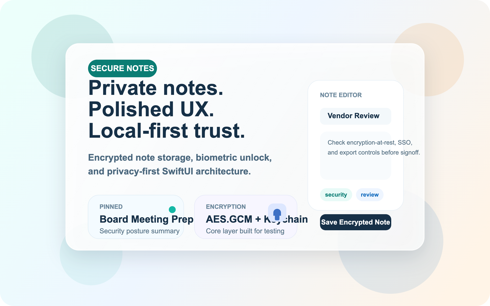

# Secure Notes Apple

A SwiftUI and Apple-platform portfolio project for encrypted personal notes, local-first privacy, and polished biometric unlock workflows.

<p>
  
  
  
</p>

## Preview Concept



## Why This Project

This project is meant to strengthen the Apple side of the portfolio with something that feels security-aware and product-ready, not just UI-focused.

The starter deliberately splits the project into:

- `SecureNotesCore` for buildable encryption and storage logic
- `AppPrototype` for SwiftUI wiring and screen structure

## Current Starter Scope

- Buildable Swift package using `CryptoKit`
- encrypted note envelope model
- in-memory and file-backed storage starters
- unit tests for encryption round trips
- SwiftUI app shell and feature starter files

## Package Verification

```bash
cd path/to/secure-notes-apple
swift test
```

## Planned App Features

- local encrypted notes with biometric unlock
- tags and favorites
- pin / archive flows
- export and secure share sheet
- future iCloud sync path with explicit trust boundaries

## Structure

- `Package.swift` package definition for `SecureNotesCore`
- `Sources/SecureNotesCore` encrypted note domain and storage starter
- `Tests/SecureNotesCoreTests` crypto and store tests
- `AppPrototype` SwiftUI shell, feature state, and view sketches
- `docs/architecture.md` product and technical roadmap

## Next Milestones

1. Turn the prototype shell into a real Xcode app target
2. Add Keychain-backed key material storage
3. Add search, note locking, and archive flows
4. Add secure export and sync architecture notes

## License

Released under the MIT License. See `LICENSE`.
